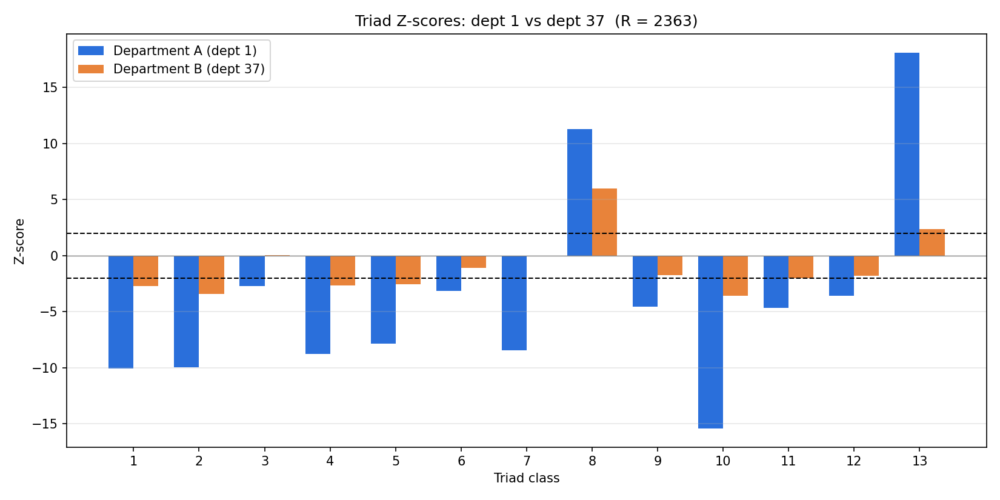

# disc-project
# Group members
Mahad Kashif Siddique(25I-0775)( Leader )
Abdul Mateen(25I-0848)
Ali Hassan(25I-0740)

# R and derived parameters

As a clean list (one line per item):
R: 0775 + 0740 + 0848 = 2363
Pair number: R mod 190 = 83 → (4, 18)
Department A: top-20[4] = Department 1 (502 internal edges)
Department B: top-20[18] = Department 37 (99 internal edges)
Random networks: 20 + (R mod 31) = 20 + 7 = 27
Swap attempts per network: (5 + (R mod 6)) × edges = (5 + 5) × edges = 10 × edges (A: 5020, B: 990)
Random seed: R = 2363

# Dataset and cleaning

The dataset is [SNAP email-Eu-core](https://snap.stanford.edu/data/email-Eu-core.html). Both files are in `data/`.

 Edge lines read: 25,571
 Self-loops removed: 642
 Duplicate edges removed: 0
 Clean simple directed graph: 1,005 nodes, 24,929 edges, 42 departments

# How to run

pip install -r requirements.txt
python main.py                 
python tests/test_triads.py    

Requirements: Python 3.8+ and matplotlib. networkx is used **only** in the test file, to cross-check our T4 counts. Running the full pipeline takes about 2 seconds.

# Project structure

main.py                 runs T1–T7 in order and prints all results
src/params.py           R and derived parameters (Section 5)
src/data_loader.py      T1 load + clean + top-20, T2 induced subgraph
src/triads.py           T3 triad_class via canonical code (+ hand example), T4 triad census
src/randomize.py        T5 double-edge swap randomization + degree assert
src/zscore.py           T6 null-model loop, mean / population std, Z-scores
src/plot.py             T7 grouped bar chart
tests/test_triads.py    correctness tests
results/                tables.txt, results.json, zscores_R2363.png
data/                   SNAP files (.txt.gz)

## Method summary

**Triad Classification (T3):**
 Triads are encoded as 6-bit integers mapping to the 6 possible directed edges. The canonical code is the minimum integer across all 6 node orderings. This reduces the 64 possible configurations into 16 orbits, where the 13 connected orbits form Classes 1–13 (codes: 3, 6, 7, 10, 11, 15, 21, 23, 25, 27, 30, 31, 63).
 **Census (T4):** 
 To avoid an inefficient $O(\vert{}V\vert{}^3)$ brute-force search, triads are found by identifying nodes with two undirected neighbors. Each triad is stored in a set as a sorted tuple, ensuring it is counted exactly once.**Randomization (T5):**
  Random networks are generated by uniformly selecting two edges $(a,b)$ and $(c,d)$ and swapping them to $(a,d)$ and $(c,b)$. Swaps that create self-loops or duplicate edges are rejected (but still count toward the attempt limit). Each random network starts from the original graph and strictly preserves every node's in-degree and out-degree.
  **Seeding:**
   The entire process is strictly reproducible. A master random state (random.Random(2363)) is used to draw exactly one independent seed for each of the 27 random networks.
  **Z-score (T6):**
   Significance is calculated as $Z = (N_{real} - \mu) / \sigma$ using the population standard deviation (if $\sigma = 0$, then $Z = 0$). A class is defined as a motif if $Z > 2$, and an anti-motif if $Z < -2$.

### Hand-worked example (T3)
Hand written work example is attached in the pdf in the zip file.

### What each class looks like

| Class | Code | Shape |
|---|---|---|
| 1 | 3 | one sender → two receivers (out-star) |
| 2 | 6 | chain x → y → z |
| 3 | 7 | mutual pair x↔y, and x → z |
| 4 | 10 | two senders → one receiver (in-star) |
| 5 | 11 | feed-forward loop x→y, x→z, y→z |
| 6 | 15 | mutual pair x↔y, both → z |
| 7 | 21 | mutual pair x↔y, z → x |
| 8 | 23 | x↔y and x↔z, no edge y–z (hub with two reciprocal contacts) |
| 9 | 25 | 3-cycle x→y→z→x |
| 10 | 27 | mutual x↔z, plus path x → y → z |
| 11 | 30 | mutual x↔z, y sends to both |
| 12 | 31 | two mutual pairs + one one-way edge |
| 13 | 63 | all six edges (fully reciprocal triangle) |

## Results
Class 1: A (N=443, μ=822.1, σ=37.74, Z=−10.04 anti) • B (N=17, μ=24.3, σ=2.69, Z=−2.71 anti)
Class 2: A (N=174, μ=837.0, σ=66.63, Z=−9.95 anti) • B (N=4, μ=24.0, σ=5.83, Z=−3.42 anti)
Class 3: A (N=1074, μ=1165.9, σ=34.07, Z=−2.70 anti) • B (N=61, μ=60.7, σ=5.58, Z=0.05)
Class 4: A (N=91, μ=303.5, σ=24.20, Z=−8.78 anti) • B (N=0, μ=6.1, σ=2.29, Z=−2.69 anti)
Class 5: A (N=59, μ=250.8, σ=24.36, Z=−7.87 anti) • B (N=4, μ=13.4, σ=3.63, Z=−2.58 anti)
Class 6: A (N=189, μ=239.0, σ=15.91, Z=−3.14 anti) • B (N=19, μ=23.6, σ=4.12, Z=−1.11)
Class 7: A (N=266, μ=529.0, σ=31.19, Z=−8.43 anti) • B (N=17, μ=17.3, σ=3.54, Z=−0.08)
Class 8: A (N=740, μ=305.4, σ=38.63, Z=11.25 motif) • B (N=50, μ=18.6, σ=5.24, Z=6.00 motif)
Class 9: A (N=1, μ=51.3, σ=11.03, Z=−4.56 anti) • B (N=0, μ=3.3, σ=1.91, Z=−1.75)
Class 10: A (N=50, μ=224.9, σ=11.37, Z=−15.39 anti) • B (N=5, μ=20.5, σ=4.35, Z=−3.57 anti)
Class 11: A (N=61, μ=106.4, σ=9.77, Z=−4.65 anti) • B (N=3, μ=8.2, σ=2.58, Z=−2.01 anti)
Class 12: A (N=370, μ=424.6, σ=15.18, Z=−3.59 anti) • B (N=48, μ=56.1, σ=4.45, Z=−1.82)
Class 13: A (N=385, μ=165.8, σ=12.13, Z=18.08 motif) • B (N=40, μ=29.7, σ=4.40, Z=2.35 motif)

# Optional network diagrams

The program also saves `network_dept_1_R2363.png` and
`network_dept_37_R2363.png` in `results/`. These are optional visualizations
of the two selected department subgraphs; they are not a separately required
deliverable in the project statement. NetworkX is used only to draw them.

We checked our T4 counts against `networkx.triadic_census` in `tests/test_triads.py`. networkx uses a different class order, so the test maps its triad names to our classes through the canonical code. networkx is **not** used anywhere in the main pipeline.

# T8: How the two departments communicate differently

Both departments share the same basic signature. **Class 8** (one person in two-way contact with two others who do not email each other) and **Class 13** (a fully reciprocal triangle) are motifs. The one-way patterns are anti-motifs: out-stars (1), chains (2), in-stars (4), feed-forward loops (5) and the "mutual pair plus path" shape (10). Email inside a department is therefore built from *reciprocated* conversations. One-way broadcasting or forwarding happens far less than the degree sequences alone would predict.

The departments differ in how strongly, and how widely, they depart from random. **Department 1** (65 people, sparse: about 12% of possible edges) has an extreme Class 13 motif (Z = 18.1) and a strong Class 8 motif (Z = 11.3). Almost every asymmetric class is a strong anti-motif, including Classes 3, 6, 7, 9 and 12. So Department 1 is organised into many tight, fully reciprocal working groups (closed teams of three or more who all email each other). These groups are linked by people who keep two-way contact with members of different groups.

**Department 37** (15 people, very dense: about 47% of possible edges) is much closer to its null model. Its dominant motif is Class 8 (Z = 6.0), while Class 13 is only just significant (Z = 2.35). Classes 3, 6, 7, 9 and 12 are not significant. In such a small, dense group, the null model already produces many mutual pairs and triangles. What stands out is hub-centred reciprocal communication: a few central people hold two-way exchanges with colleagues who talk less to each other. Department 37 is a small, coordinator-centred team, whereas Department 1 is a larger collection of closed reciprocal cliques. Department 37 is small, so its Z-scores have less statistical power, and this comparison should be read with that in mind.

## Why the edge swap preserves degrees (and why it matters)

When (a,b) and (c,d) become (a,d) and (c,b):
 a still has exactly one out-edge in the pair, and so does c, so out-degrees are unchanged.
 b still has one in-edge (now from c), and so does d (now from a), so in-degrees are unchanged.

Because every random graph has exactly the same in- and out-degree sequence as G, any triad counts that come purely from degrees appear equally in G and in the random graphs. For example, a node with out-degree d is automatically the centre of C(d,2) out-stars. Those counts cancel out in N_real − μ. A large |Z| therefore shows structure *beyond* the degree sequence, which is the definition of a motif.

# Contributions

> **Edit this section so it matches exactly what each member actually committed.**

25I-0775  `src/params.py`, `src/data_loader.py` (T1, T2), `main.py` pipeline, README,video editing |
25I-0740  `src/triads.py` (T3 canonical code + hand example, T4 census), `tests/test_triads.py` |
25I-0848  `src/randomize.py` (T5 + degree assert), `src/zscore.py` (T6), `src/plot.py` (T7), T8 analysis |

# Reference

Milo, R., Shen-Orr, S., Itzkovitz, S., Kashtan, N., Chklovskii, D., & Alon, U. (2002). Network Motifs: Simple Building Blocks of Complex Networks. *Science*, 298(5594), 824–827.
